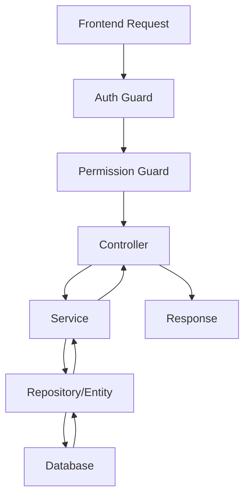

# Módulos del Sistema

## 📋 Descripción General

El sistema está organizado en módulos independientes que manejan diferentes aspectos del negocio. Cada módulo sigue la misma arquitectura y patrones para mantener consistencia y facilitar el mantenimiento.

## 🏗️ Arquitectura Modular

```
src/
├── common/                 # Utilidades compartidas
├── database/               # Configuración y migraciones
├── inventory/              # Gestión de productos e inventario
├── crm/                    # Gestión de clientes y relaciones
├── company/                # Configuración de empresa y tiendas
├── users/                  # Autenticación y autorización
└── app.module.ts           # Módulo raíz
```

## 📦 Módulos Principales

### 1. 🏪 Inventory Module

**Responsabilidad**: Gestión completa de productos, categorías, inventario y stock.

#### Entidades
- **ProductEntity**: Productos del catálogo
- **CategoryEntity**: Categorías de productos
- **BatchEntity**: Lotes de productos
- **ProductOutputEntity**: Salidas de inventario

#### Endpoints Principales
```
GET    /product                    # Listar productos con filtros
POST   /product                    # Crear producto
GET    /product/:id                # Obtener producto específico
PATCH  /product/:id                # Actualizar producto
DELETE /product/:id                # Eliminar producto
GET    /product/category/:id       # Productos por categoría
GET    /product/sku/:sku           # Buscar por SKU
PATCH  /product/:id/stock/:qty     # Actualizar stock

GET    /category                   # Listar categorías
POST   /category                   # Crear categoría
```

#### Características Especiales
- **Gestión de stock** en tiempo real
- **Validación de SKU único**
- **Relaciones con categorías y marcas**
- **Búsquedas optimizadas** por diferentes criterios
- **Endpoints de IA** para generación automática de productos

### 2. 👥 CRM Module

**Responsabilidad**: Gestión de clientes, relaciones comerciales y comunicación.

#### Entidades
- **CustomerEntity**: Información de clientes
- **ContactEntity**: Contactos de clientes
- **InteractionEntity**: Historial de interacciones
- **SegmentEntity**: Segmentación de clientes

#### Endpoints Principales
```
GET    /customer                   # Listar clientes
POST   /customer                   # Crear cliente
GET    /customer/:id               # Obtener cliente específico
PATCH  /customer/:id               # Actualizar cliente
DELETE /customer/:id               # Eliminar cliente
GET    /customer/:id/orders        # Pedidos del cliente
GET    /customer/segment/:id       # Clientes por segmento
```

#### Características Especiales
- **Segmentación automática** de clientes
- **Historial completo** de interacciones
- **Métricas de engagement**
- **Integración con sistemas de email**

### 3. 🏢 Company Module

**Responsabilidad**: Configuración de empresa, tiendas, marcas y configuraciones generales.

#### Entidades
- **StoreEntity**: Tiendas/sucursales
- **BrandEntity**: Marcas de productos
- **OrganizationEntity**: Organizaciones
- **ProjectEntity**: Proyectos
- **PlanEntity**: Planes de suscripción
- **TokenEntity**: Tokens de API
- **PaymentGatewayEntity**: Pasarelas de pago

#### Endpoints Principales
```
GET    /store                      # Listar tiendas
POST   /store                      # Crear tienda
GET    /brand                      # Listar marcas
POST   /brand                      # Crear marca
GET    /organization               # Listar organizaciones
GET    /payment-gateway            # Pasarelas de pago
```

#### Características Especiales
- **Multi-tienda** support
- **Configuración de pasarelas** de pago
- **Gestión de planes** y suscripciones
- **API tokens** para integraciones

### 4. 👤 Users Module

**Responsabilidad**: Autenticación, autorización, usuarios y permisos.

#### Entidades
- **UserEntity**: Usuarios del sistema
- **RoleEntity**: Roles de usuario
- **PermissionEntity**: Permisos granulares
- **SessionEntity**: Sesiones activas

#### Endpoints Principales
```
POST   /auth/login                 # Iniciar sesión
POST   /auth/register              # Registrar usuario
POST   /auth/refresh               # Renovar token
GET    /user                       # Listar usuarios
POST   /user                       # Crear usuario
GET    /role                       # Listar roles
POST   /role                       # Crear rol
GET    /permission                 # Listar permisos
```

#### Características Especiales
- **JWT Authentication** con refresh tokens
- **Role-Based Access Control** (RBAC)
- **Permisos granulares** por recurso
- **Guards personalizados** para protección
- **Middleware de autenticación**

### 5. 🔧 Common Module

**Responsabilidad**: Utilidades, constantes y recursos compartidos entre módulos.

#### Componentes
- **DTOs compartidos**: QueryDto, ResponseDto
- **Guards globales**: AuthGuard, PermissionGuard
- **Decorators**: PermissionAccess, CurrentUser
- **Filters**: Exception filters globales
- **Interfaces**: ResponseMessage, ResponseGet
- **Constants**: ORDER_ENUM, PERMISSION
- **Utils**: Helpers y utilidades

### 6. 🗄️ Database Module

**Responsabilidad**: Configuración de base de datos, migraciones y seeders.

#### Componentes
- **Configuración TypeORM**
- **Migraciones automáticas**
- **Seeders de datos iniciales**
- **Conexión con PostgreSQL**

## 🔄 Interacciones Entre Módulos

### Flujo de Datos Típico



### Dependencias Entre Módulos

```
Users ← Company ← Inventory
  ↑       ↑         ↑
  └─── CRM ←────────┘
```

- **Users**: Base para autenticación y autorización
- **Company**: Configuración de tiendas y marcas
- **Inventory**: Depende de Company para marcas y tiendas
- **CRM**: Integra con todos para gestión completa de clientes

## 📝 Convenciones por Módulo

### Estructura Estándar
```
src/[modulo]/
├── controllers/              # REST endpoints
│   ├── [recurso].controller.ts
│   └── [otro-recurso].controller.ts
├── services/                 # Lógica de negocio
│   ├── [recurso].service.ts
│   └── [otro-recurso].service.ts
├── entities/                 # Modelos de BD
│   ├── [recurso].entity.ts
│   └── [otro-recurso].entity.ts
├── dto/                      # Data Transfer Objects
│   ├── create-[recurso].dto.ts
│   ├── update-[recurso].dto.ts
│   └── index.ts
├── guards/                   # Guards específicos (opcional)
├── decorators/               # Decorators específicos (opcional)
└── [modulo].module.ts        # Configuración del módulo
```

### Nomenclatura
- **Entities**: `[Nombre]Entity`
- **Services**: `[Nombre]Service`
- **Controllers**: `[Nombre]Controller`
- **DTOs**: `Create[Nombre]Dto`, `Update[Nombre]Dto`
- **Modules**: `[Nombre]Module`

## 🔐 Permisos por Módulo

### Inventory
```typescript
GESTIONAR_PRODUCTOS
GESTIONAR_CATEGORIAS
GESTIONAR_INVENTARIO
VER_REPORTES_INVENTARIO
```

### CRM
```typescript
GESTIONAR_CLIENTES
VER_CLIENTES
GESTIONAR_SEGMENTOS
VER_METRICAS_CRM
```

### Company
```typescript
GESTIONAR_TIENDAS
GESTIONAR_MARCAS
CONFIGURAR_EMPRESA
GESTIONAR_PASARELAS
```

### Users
```typescript
GESTIONAR_USUARIOS
GESTIONAR_ROLES
GESTIONAR_PERMISOS
VER_AUDITORIA
```

## 🌱 Seeders por Módulo

### Orden de Ejecución
1. **Users Seeder**: Usuarios base y permisos
2. **Company Seeder**: Organizaciones, tiendas, marcas
3. **Inventory Seeder**: Categorías y productos
4. **CRM Seeder**: Clientes y segmentos

### Comandos
```bash
# Ejecutar todos los seeders
npm run seed

# Seeders individuales
npm run seed:users
npm run seed:company
npm run seed:inventory
npm run seed:crm
```

## 🧪 Testing por Módulo

### Estructura de Tests
```
src/[modulo]/__tests__/
├── unit/
│   ├── [recurso].service.spec.ts
│   └── [recurso].controller.spec.ts
├── integration/
│   └── [modulo].integration.spec.ts
└── e2e/
    └── [modulo].e2e-spec.ts
```

### Comandos de Testing
```bash
# Tests por módulo
npm run test -- inventory
npm run test -- crm
npm run test -- company
npm run test -- users

# E2E tests
npm run test:e2e -- inventory
```

## 📊 Métricas y Monitoreo

Cada módulo incluye:
- **Logging estructurado** con contexto
- **Métricas de performance** por endpoint
- **Health checks** específicos
- **Documentación Swagger** completa

## 🚀 Escalabilidad

### Módulos Futuros Planificados
- **Orders Module**: Gestión de pedidos y órdenes
- **Sales Module**: Análisis de ventas y reportes
- **Analytics Module**: Business Intelligence
- **Notifications Module**: Sistema de notificaciones
- **Audit Module**: Auditoría y logs de sistema

### Consideraciones de Arquitectura
- **Microservicios ready**: Cada módulo puede ser extraído
- **Event-driven**: Preparado para eventos entre módulos
- **API Gateway**: Compatible con gateway centralizado
- **Caching**: Redis integration ready
- **Queue System**: Bull/Redis para procesos async

Este diseño modular permite **escalabilidad horizontal**, **mantenimiento simplificado** y **desarrollo en equipo** eficiente.