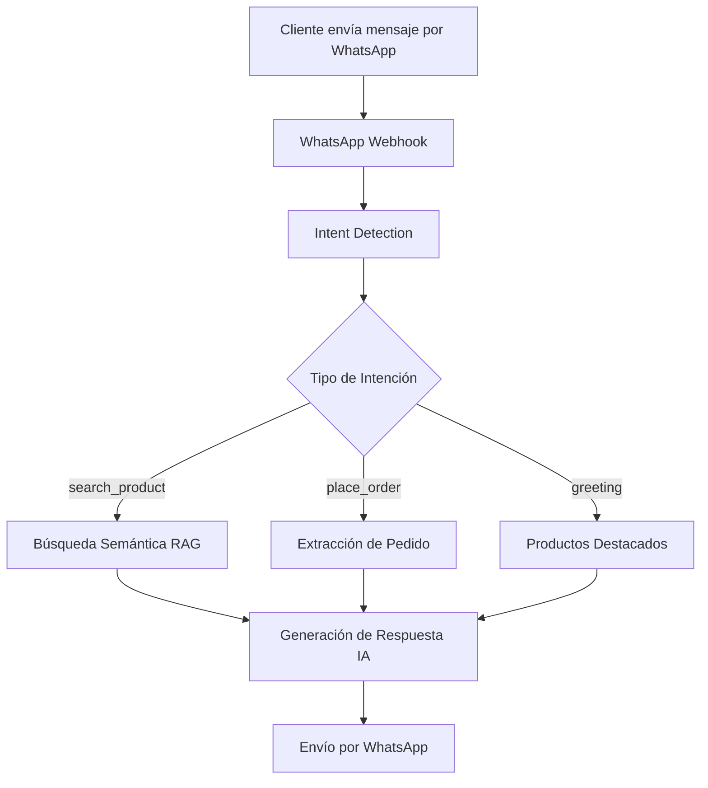

# Sistema RAG (Retrieval-Augmented Generation) para IA Conversacional

## Descripción General

Se ha implementado un sistema RAG completo que permite a las tiendas virtuales tener un asistente de IA conversacional a través de WhatsApp. El sistema combina búsquedas semánticas sobre el catálogo de productos con generación natural de lenguaje, proporcionando respuestas precisas y contextuales a los clientes.

## Arquitectura del Sistema

### Componentes Principales

1. **ProductEmbeddingEntity**: Almacena vectores de embeddings de productos
2. **EmbeddingService**: Genera y gestiona embeddings usando OpenAI
3. **RagService**: Realiza búsquedas semánticas y genera respuestas
4. **IntentService**: Detecta intenciones usando OpenAI Function Calling
5. **ConversationController**: API para gestión de conversaciones
6. **WhatsAppController**: Webhook para integración con WhatsApp

### Flujo de Funcionamiento



## Entidades y Base de Datos

### ProductEmbeddingEntity

```typescript
@Entity({ name: 'product_embedding' })
export class ProductEmbeddingEntity extends BaseEntity {
  @Column('vector', { length: 1536 })
  embedding: number[];

  @Column({ type: 'text', nullable: false })
  content: string;

  @Column({ type: 'varchar', length: 64, nullable: false })
  contentHash: string;

  @OneToOne(() => ProductEntity, { onDelete: 'CASCADE' })
  @JoinColumn()
  product: ProductEntity;

  @Column()
  productId: string;
}
```

**Requisitos de Base de Datos:**
- PostgreSQL con extensión `pgvector`
- Comando para instalar: `CREATE EXTENSION IF NOT EXISTS vector;`

## Servicios Implementados

### 1. EmbeddingService

**Funcionalidades:**
- Genera embeddings automáticamente al crear/actualizar productos
- Utiliza OpenAI `text-embedding-3-small` (1536 dimensiones)
- Detecta cambios en productos usando hash MD5
- Soporte para regeneración masiva de embeddings

**Métodos principales:**
```typescript
generateProductEmbedding(productId: string): Promise<ProductEmbeddingEntity>
generateBulkEmbeddings(productIds: string[]): Promise<void>
generateQueryEmbedding(query: string): Promise<number[]>
regenerateStoreEmbeddings(storeId: string): Promise<void>
```

### 2. RagService

**Funcionalidades:**
- Búsqueda semántica usando similitud coseno
- Generación de respuestas contextuales con GPT-4
- Filtrado por tienda y stock disponible
- Análisis de sentimientos

**Métodos principales:**
```typescript
searchProducts(query: string, storeId: string, limit?: number): Promise<SearchResult[]>
generateResponse(userMessage: string, storeId: string): Promise<RAGResponse>
searchByCategory(categoryName: string, storeId: string): Promise<ProductEntity[]>
searchByPriceRange(minPrice: number, maxPrice: number, storeId: string): Promise<ProductEntity[]>
```

### 3. IntentService

**Funcionalidades:**
- Detección de intenciones usando OpenAI Function Calling
- Extracción de información de pedidos
- Clasificación de confirmaciones y negaciones
- Extracción de información de contacto

**Intenciones Soportadas:**
- `search_product`: Búsqueda de productos
- `place_order`: Realizar pedido
- `confirm_order`: Confirmar pedido
- `cancel_order`: Cancelar pedido
- `check_order_status`: Consultar estado
- `check_business_hours`: Horarios de atención
- `greeting`: Saludos

## Controladores y API

### ConversationController

**Endpoints principales:**

#### POST /conversation/process-message
Procesa mensajes usando RAG e Intent Detection.

```typescript
{
  "message": "¿Tienen proteína vegana?",
  "storeId": "uuid",
  "conversationHistory": [...]
}
```

#### POST /conversation/search-products
Búsqueda semántica directa de productos.

```typescript
{
  "query": "proteína vegana",
  "storeId": "uuid",
  "limit": 10,
  "similarityThreshold": 0.7
}
```

#### POST /conversation/generate-embeddings
Genera embeddings para productos específicos o toda la tienda.

```typescript
{
  "storeId": "uuid",
  "productIds": ["uuid1", "uuid2"] // opcional
}
```

### WhatsAppController

**Endpoints:**

#### GET /whatsapp/webhook
Verificación del webhook de WhatsApp.

#### POST /whatsapp/webhook
Recibe mensajes de WhatsApp y los procesa automáticamente.

## Integración con WhatsApp

### Configuración Requerida

**Variables de Entorno:**
```env
WHATSAPP_VERIFY_TOKEN=mi_token_secreto
WHATSAPP_ACCESS_TOKEN=tu_access_token_de_facebook
DEFAULT_STORE_ID=uuid_de_tienda_por_defecto
OPENAI_API_KEY=tu_openai_api_key
```

### Flujo de Conversación

1. **Cliente envía mensaje** → WhatsApp Cloud API
2. **Webhook recibe mensaje** → WhatsAppController
3. **Detección de intención** → IntentService
4. **Procesamiento según intención:**
   - Búsqueda de productos → RagService
   - Pedidos → Extracción y validación
   - Saludos → Productos destacados
5. **Generación de respuesta** → OpenAI GPT-4
6. **Envío de respuesta** → WhatsApp Cloud API

## Integración Automática con Productos

### ProductService Modificado

El servicio de productos ahora genera embeddings automáticamente:

```typescript
// Al crear producto
const savedProduct = await this.productRepository.save(product);
this.generateProductEmbeddingAsync(savedProduct.id);

// Al actualizar producto
const updatedProduct = await this.productRepository.save(product);
this.generateProductEmbeddingAsync(updatedProduct.id);

// Al eliminar producto
this.deleteProductEmbeddingAsync(id);
await this.productRepository.remove(product);
```

## Prompts y Configuración de IA

### Archivo de Prompts: `rag.prompts.ts`

Contiene todos los prompts organizados:
- `GENERATE_RESPONSE`: Generación de respuestas con contexto
- `INTENT_CLASSIFICATION`: Clasificación de intenciones
- `EXTRACT_ORDER_ENTITIES`: Extracción de información de pedidos
- `PRODUCT_DESCRIPTION_FOR_EMBEDDING`: Texto para embeddings

### Funciones de OpenAI

Configuradas para Intent Detection con parámetros específicos:
```typescript
const INTENT_FUNCTIONS = [
  {
    name: 'search_product',
    description: 'El cliente busca información sobre productos',
    parameters: { ... }
  },
  // ... más funciones
];
```

## Rendimiento y Optimización

### Embeddings
- **Modelo**: `text-embedding-3-small` (1536 dimensiones)
- **Costo**: ~$0.00002 por 1K tokens
- **Generación**: Asíncrona para no bloquear respuestas

### Búsquedas
- **Índice vectorial**: Automático con pgvector
- **Filtros**: Por tienda, stock, similitud
- **Límite**: Máximo 50 resultados por búsqueda

### Respuestas IA
- **Modelo**: GPT-4 para respuestas
- **Contexto**: Solo productos relevantes (3-5)
- **Tokens**: Optimizado para reducir costos

## Monitoreo y Logs

### Logs Implementados
- Generación de embeddings (éxito/error)
- Búsquedas semánticas con métricas
- Detección de intenciones con confianza
- Mensajes de WhatsApp procesados
- Errores de integración

### Métricas Disponibles
```typescript
// GET /conversation/embedding-stats/:storeId
{
  "totalEmbeddings": 150,
  "productsWithEmbeddings": 150,
  "productsWithoutEmbeddings": 0
}
```

## Casos de Uso Implementados

### 1. Búsqueda de Productos
**Cliente:** "¿Tienen proteína vegana?"
**Sistema:** Busca productos similares → Genera respuesta con opciones disponibles

### 2. Realización de Pedidos
**Cliente:** "Quiero 2 proteínas y 1 creatina"
**Sistema:** Extrae productos y cantidades → Solicita confirmación

### 3. Confirmación de Pedidos
**Cliente:** "Sí, confirmo"
**Sistema:** Confirma pedido → Solicita datos de contacto si faltan

### 4. Información General
**Cliente:** "¿Qué horarios tienen?"
**Sistema:** Responde con horarios configurados

## Próximas Mejoras

### Funcionalidades Pendientes
1. **Gestión de pedidos completa** - Integración con OrderService
2. **Historial de conversaciones** - Almacenamiento persistente
3. **Múltiples idiomas** - Soporte para otros idiomas
4. **Análisis de métricas** - Dashboard de conversaciones
5. **Integración con CRM** - Gestión de clientes automática

### Optimizaciones Técnicas
1. **Cache de embeddings** - Redis para consultas frecuentes
2. **Batch processing** - Procesamiento masivo de mensajes
3. **Rate limiting** - Control de límites de API
4. **Fallbacks** - Respuestas cuando falla la IA

## Seguridad y Consideraciones

### Validaciones Implementadas
- Verificación de webhook de WhatsApp
- Validación de tokens de acceso
- Sanitización de mensajes de entrada
- Límites en consultas y respuestas

### Datos Sensibles
- Tokens de WhatsApp en variables de entorno
- API keys de OpenAI protegidas
- Información de clientes manejada según privacidad

## Conclusión

El sistema RAG implementado proporciona una base sólida para IA conversacional en e-commerce, combinando búsquedas semánticas precisas con generación natural de respuestas. La arquitectura modular permite extensiones futuras y mantiene un rendimiento óptimo para tiendas de cualquier tamaño.
